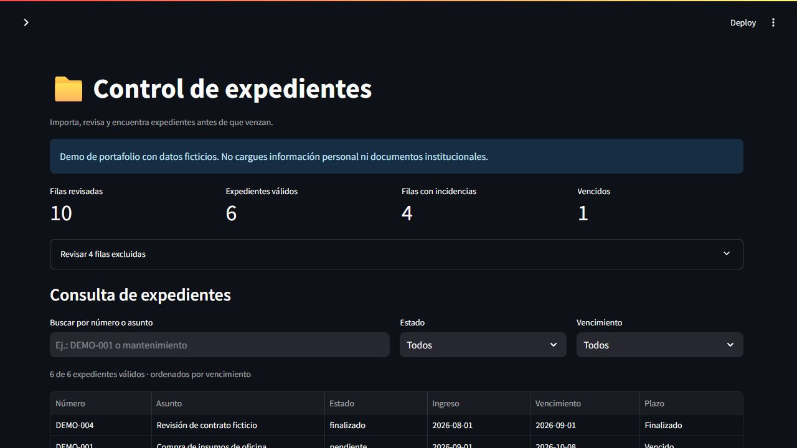

# Asistente para control y consulta de expedientes

Aplicación de Python y Streamlit que importa expedientes desde CSV o Excel,
detecta registros inválidos y permite consultar pendientes por estado y vencimiento.
Proyecto personal de **Iván Núñez López**, orientado a practicar programación,
validación de datos y automatización de procesos administrativos.

**Estado: MVP funcional.** La búsqueda actual es por texto y filtros; todavía no
utiliza inteligencia artificial ni modelos de lenguaje.



## Problema

Una planilla puede contener números repetidos, campos incompletos o fechas
incorrectas. Revisarlos manualmente dificulta identificar qué expedientes requieren
atención. Esta herramienta separa las filas válidas de las incidencias y organiza
los resultados por vencimiento, sin modificar el archivo original.

## Funciones

- Importar `.csv` en UTF-8 (coma, punto y coma o tabulador) y `.xlsx` (primera hoja).
- Validar campos obligatorios, estados y fechas, incluido el orden ingreso/vencimiento.
- Detectar números duplicados sin distinguir mayúsculas ni espacios en los extremos.
- Mostrar el número de fila y el motivo de cada rechazo. Se conserva la primera
  aparición válida de cada número.
- Buscar por número o asunto, sin distinguir tildes ni mayúsculas.
- Filtrar por estado, expedientes vencidos o próximos a vencer en siete días.
- Elegir una fecha de referencia para reproducir los resultados de la demo.
- Exportar los resultados filtrados a CSV, protegiendo los textos que podrían
  interpretarse como fórmulas al abrirlos en una planilla.

## Ejecutar localmente

Requiere Python 3.11 o 3.12.

```bash
git clone https://github.com/ivan-nl-nl/asistente-expedientes.git
cd asistente-expedientes
python -m venv .venv
```

Activar el entorno en PowerShell:

```powershell
.\.venv\Scripts\Activate.ps1
```

En Linux/macOS:

```bash
source .venv/bin/activate
```

Instalar dependencias e iniciar:

```bash
python -m pip install -r requirements.txt
python -m streamlit run app.py
```

Abrir la dirección local indicada por Streamlit, normalmente `http://localhost:8501`.
No se requieren claves API, cuentas de pago ni conexión a un proveedor de IA.

## Probar la demo

1. Dejar activado **Usar datos de demostración**.
2. Elegir **2026-10-11** como fecha de referencia.
3. Se mostrarán 10 filas revisadas, 6 expedientes válidos, 4 filas con incidencias
   y 1 expediente vencido. Los errores son intencionales para demostrar la validación.
4. Seleccionar **Próximos 7 días**: aparecerán DEMO-003, DEMO-002 y DEMO-005.
5. Exportar los resultados o descargar el archivo de ejemplo para modificarlo.

Para importar otro archivo, desactivar el modo de demostración. Un archivo nuevo
reemplaza los datos de la vista; no se acumulan importaciones.

## Formato de entrada

```csv
numero,asunto,estado,fecha_ingreso,fecha_vencimiento
DEMO-001,Compra de insumos,pendiente,2026-10-01,2026-10-15
```

Los cinco campos son obligatorios. Estados: `pendiente`, `en proceso`, `observado`
y `finalizado`. Fechas: `AAAA-MM-DD`; en Excel también se aceptan celdas de fecha.
Conviene guardar los números de expediente como texto para conservar ceros iniciales.
Las hojas adicionales del Excel no se procesan. Las fórmulas de Excel no se ejecutan;
solo se leen sus valores guardados, cuando existen.

Un expediente está vencido cuando su fecha de vencimiento es anterior a la referencia
y no está finalizado. Los próximos siete días incluyen la fecha de referencia y el
séptimo día; se excluyen los finalizados.

## Pruebas

```bash
python -m unittest discover -s tests -v
```

14 pruebas de CSV y Excel, duplicados, fechas imposibles, columnas faltantes, búsqueda,
límites de vencimiento, exportación e interfaz Streamlit. GitHub Actions las ejecuta
en cada push y pull request.

## Estructura

```text
app.py                       Interfaz Streamlit
expedientes.py               Importación, validación, filtros y exportación
data/expedientes_demo.csv     Datos ficticios con errores intencionales
tests/test_expedientes.py     Pruebas automatizadas
.github/workflows/tests.yml   Integración continua
```

## Datos y alcance

Todos los registros del ejemplo son ficticios. El proyecto no está afiliado a una
institución pública ni conectado a sistemas municipales. No subas documentos reales,
datos personales ni archivos de trabajo al repositorio o a una demo pública.

La aplicación procesa archivos en memoria y no incluye persistencia, autenticación,
auditoría ni controles para uso institucional. Es un prototipo de portafolio, no un
sistema de producción.

## Próximas mejoras

- Agregar persistencia local con SQLite y un historial de importaciones.
- Incorporar búsqueda semántica con datos ficticios y un conjunto de evaluación.
- Explorar resúmenes asistidos por IA con referencias a los registros originales.

## Aprendizajes que demuestra

Separación de lógica e interfaz, manejo de errores, normalización de texto, fechas,
lectura de archivos, pruebas automatizadas y traducción de un proceso administrativo
a reglas verificables. Este MVP no implica experiencia profesional en desarrollo o IA.
